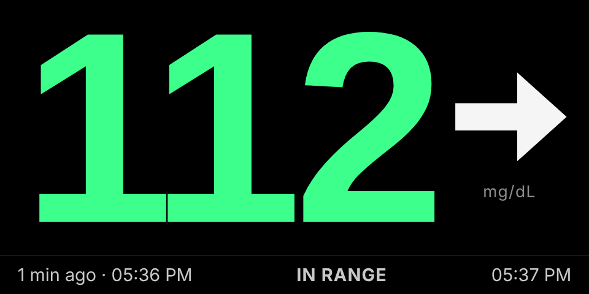
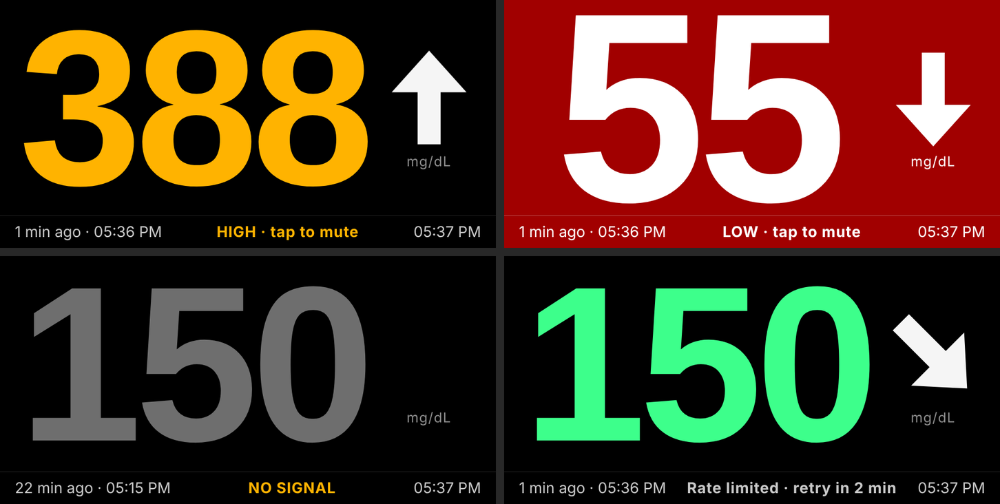

# Echo Show CGM Dashboard

Turn a jailbroken **Amazon Echo Show 5** into a bedside glucose display for
**FreeStyle Libre**. If you already have the Echo, there's nothing to buy: no
ESP32, no Raspberry Pi, no Nightscout server. Everything runs on the Echo
itself. A small Flask server in Termux reads LibreLinkUp once a minute, and
Fully Kiosk Browser shows the number full-screen with high/low alarms.



> **Not a medical device.** This uses LibreLinkUp's unofficial API, which
> Abbott can change or block at any time. Keep the alarms in your phone's
> LibreLink app turned on and treat this as a convenience display.

## Features

- Huge, readable number and trend arrow sized for a 960×480 screen
- Green in range, amber high, pulsing red low, grey **NO SIGNAL** when data
  is more than 10 minutes old
- Alarm sound below 70 or above 180 mg/dL (both configurable). Tap the screen
  to mute for 15 min; it re-arms once you're back in range
- Exactly one LibreLinkUp request per minute, however often the page reloads.
  Handles rate limits, expired sessions and region redirects on its own
- Listens on `localhost` only, so nothing else on your Wi-Fi can read it
- Mock mode to test the screen and sound without an account



## What you need

- **An Echo Show 5, 2nd gen (2021, codename "cronos")**, unlocked and running
  LineageOS 18.1. That's the setup this was built and tested on. Unlock it with
  [Rortiz2's XDA guide](https://xdaforums.com/t/unlock-root-twrp-unbrick-amazon-echo-show-5-2nd-gen-2021-cronos.4772596/),
  then flash the
  [unofficial LineageOS 18.1 build for cronos](https://xdaforums.com/t/rom-unofficial-11-cronos-lineageos-18-1-for-the-amazon-echo-show-5-2021.4772598/).
  Any other Android device that runs Termux should work too.
- **A FreeStyle Libre sensor shared to LibreLinkUp.** Make a LibreLinkUp
  account, accept the invite from the LibreLink app, and sign in to the
  LibreLinkUp app once so it accepts the terms.
- **A computer with [adb](https://developer.android.com/tools/releases/platform-tools)**
  to install the apps.

## Setup

### 1. Prepare the Echo

1. In LineageOS, enable USB debugging: **Settings → About tablet**, tap
   **Build number** 7 times, then **Settings → System → Advanced → Developer
   options → USB debugging**.
2. Install [Termux](https://github.com/termux/termux-app/releases) and
   [Fully Kiosk Browser](https://www.fully-kiosk.com/) from your computer.
   Pick the Termux APK that matches the CPU:
   ```bash
   adb shell getprop ro.product.cpu.abi      # arm64-v8a or armeabi-v7a
   adb install termux-app_<version>+github-debug_<that-abi>.apk
   adb install <fully-kiosk>.apk
   ```
3. Stop Android from killing Termux in the background: **Settings → Apps &
   notifications → Special app access → Battery optimization → All apps →
   Termux → Don't optimize**.

> **Tip:** typing on a 5-inch screen is painful. You can type any command
> into the open Termux window from your computer:
> `adb shell "input text 'your command here' && input keyevent 66"`

### 2. Install Python and the libraries

Open Termux on the Echo and run:

```bash
pkg update -y && pkg upgrade -y
pkg install -y python python-pip git nano
```

`pylibrelinkup` needs `pydantic-core`, which is written in Rust and has no
official Android build. Compiling it on the Echo fails: it runs out of
memory, even with a swap file. Install a prebuilt build from
[android-pydantic-core](https://github.com/Eutalix/android-pydantic-core)
instead:

```bash
cd ~
curl -O https://raw.githubusercontent.com/Eutalix/android-pydantic-core/main/install_pydantic_core.sh
bash install_pydantic_core.sh
pip install flask pylibrelinkup
python -c "import flask, pylibrelinkup; print('OK')"
```

That installer picks the build matching your Python version and CPU from the
project's GitHub releases, which GitHub Actions compiles from the official
pydantic source. It's a third-party project, so read the script before you
run it.

<details>
<summary>Compiling pydantic-core yourself instead</summary>

This works on stronger Android devices; on the Echo it ran out of memory.

```bash
pkg install -y rust binutils
termux-wake-lock
export ANDROID_API_LEVEL=$(getprop ro.build.version.sdk)   # 30 on LineageOS 18.1
export CARGO_BUILD_JOBS=1 CARGO_PROFILE_RELEASE_LTO=off
export CARGO_PROFILE_RELEASE_CODEGEN_UNITS=16 CARGO_PROFILE_RELEASE_OPT_LEVEL=1
pip install flask pylibrelinkup
```

If you add a swap file to get through the build, delete it afterwards. The
Echo only has 8 GB of storage, and a full disk breaks downloads with errors
like `curl: failed writing body`.
</details>

### 3. Get the dashboard

```bash
git clone https://github.com/Velcy-a/echo-show-cgm-dashboard.git ~/cgm-dashboard
cd ~/cgm-dashboard
cp config.env.example config.env
nano config.env          # set LIBRE_EMAIL, LIBRE_PASSWORD, LIBRE_REGION
chmod 600 config.env
```

Keep it in Termux's home folder (`~`). Android won't run scripts from
`/sdcard`, so starting it from Downloads fails with *Permission denied*.

If editing on the Echo is too fiddly, fill in `config.env` on your computer
and push it over. Run `termux-setup-storage` once in Termux and tap **Allow**
first:

```bash
adb push config.env /sdcard/Download/                       # on the computer
cp ~/storage/downloads/config.env ~/cgm-dashboard/          # in Termux
```

A `config.env` saved with Windows line endings works fine.

### 4. Test with fake data

```bash
./start.sh --mock
```

Open Fully Kiosk Browser (settings below). The fake reading swings from about
45 to 215 mg/dL over 20 minutes, so you'll see and hear both alarms. Press
**CTRL** then **c** in Termux to stop it.

### 5. Run it for real

```bash
./start.sh
```

```
... INFO    cgm: Starting LibreLinkUp poller (every 60 s); dashboard on http://127.0.0.1:5000
... INFO    cgm: Logged in to LibreLinkUp (EU)
... INFO    cgm: Glucose 112 mg/dL →
```

If your account lives in another region, the log says so and the login
follows the redirect automatically. Put that region in `LIBRE_REGION` to skip
the redirect next time.

### 6. Fully Kiosk Browser settings

All of these are in the free version; nothing here needs a Fully PLUS license.

- **Start URL:** `http://localhost:5000`
- **Web Content Settings → Autoplay Audio:** on. Without it, the page asks
  for one tap after each load before it can play the alarm.
- **Device Management → Keep Screen On:** on
- **Auto reload after page error:** on, so the page recovers if it loads
  before the server is up
- Turn the media volume up. The alarm plays through the media stream.

### 7. Start automatically after a power cut

The Echo has no battery, so any power blip reboots it. Without this step the
dashboard stays down until you start it again by hand.

Install **Termux:Boot** from the same place you got Termux (builds from
F-Droid and GitHub can't be mixed), open it once, then:

```bash
mkdir -p ~/.termux/boot
cat > ~/.termux/boot/cgm-dashboard <<'EOF'
#!/data/data/com.termux/files/usr/bin/sh
termux-wake-lock
cd ~/cgm-dashboard && ./start.sh >> server.log 2>&1
EOF
chmod +x ~/.termux/boot/cgm-dashboard
```

## Everyday use

- **Stop:** press CTRL then c in Termux. If you only kill the Python
  process, `start.sh` brings it back 10 seconds later.
- **Update:** `cd ~/cgm-dashboard && git pull`, then restart.
- **After `pkg upgrade` moves Python to a new version**, re-run
  `bash ~/install_pydantic_core.sh` and `pip install flask pylibrelinkup`.
  Until you do, the page shows *Dashboard server not responding*.
- **Settings:** alarm thresholds, snooze length, the stale-data timeout and
  the poll interval are all in `config.env` (see `config.env.example`).

## Troubleshooting

| Symptom | Fix |
|---|---|
| `Login failed … terms` / `privacy policy` | Open the LibreLinkUp app with this account and accept them. |
| `Login failed: Invalid login credentials` | Check `config.env`. Retries wait 15 min so they can't lock the account. |
| `Rate limited by LibreLinkUp` | Keep `POLL_SECONDS` at 60 or more, and stop other tools that read the same account. |
| `No matching connection` | Accept the invite in LibreLinkUp, or fix `LIBRE_PATIENT_ID`. |
| Login suddenly fails for everyone | Abbott may have raised its minimum app version. Run `pip install -U pylibrelinkup`. |
| No alarm sound | Turn on Autoplay in Fully (or tap once), raise the media volume. |
| `Permission denied` running `start.sh` | You're running it from `/sdcard`. Use `~/cgm-dashboard`. |
| `cannot stat '/sdcard/…'` | Run `termux-setup-storage` and tap Allow. |
| `curl: failed writing body` | Storage is full. Delete any swap file you made. |
| *Dashboard server not responding* | Termux was stopped. Start it again, and set up step 7. |

## How it works

```
cgm-dashboard/
├── app.py               Flask server + background LibreLinkUp poller
├── templates/index.html Dashboard (HTML, CSS and JS in one file)
├── static/alarm.mp3     Alarm sound (replace with any MP3)
├── config.env.example   Settings template → copy to config.env
├── start.sh             Loads config.env, holds a wake lock, restarts on crash
└── requirements.txt
```

A background thread logs in once, reuses the session, and calls
LibreLinkUp's `latest()` every 60 s. The page polls `GET /api/data`, which
only reads that cached result:

```json
{
  "status": "ok", "error": null,
  "value": 112, "trend": 3, "trend_name": "STABLE", "arrow": "→",
  "timestamp": "2026-10-09T20:14:00+00:00", "timestamp_ms": 1791576840000,
  "age_seconds": 42, "stale": false,
  "fetched_at_ms": 1791576871000, "next_poll_ms": 1791576931000,
  "server_time_ms": 1791576882000
}
```

`value` is always mg/dL. `trend` is 1 falling fast, 2 falling, 3 stable,
4 rising, 5 rising fast, or 0 unknown. When a poll fails, `status` becomes
`"error"` with a readable `error`, and the last good reading stays on screen
with its age.

## Credits

This project is only the dashboard. It wouldn't run without:

- **Echo Show 5 unlock** (amonet for cronos) by
  [Rortiz2 / R0rt1z2](https://xdaforums.com/t/unlock-root-twrp-unbrick-amazon-echo-show-5-2nd-gen-2021-cronos.4772596/),
  building on xyz\`'s original amonet exploit, with help from AntiEngineer,
  alextrack2013 and gilderchuck
- **LineageOS 18.1 for cronos** by
  [bengris32, R0rt1z2 and FieryFlames](https://xdaforums.com/t/rom-unofficial-11-cronos-lineageos-18-1-for-the-amazon-echo-show-5-2021.4772598/)
- [pylibrelinkup](https://github.com/robberwick/pylibrelinkup) by Rob Berwick
  (MIT) for the LibreLinkUp client
- [android-pydantic-core](https://github.com/Eutalix/android-pydantic-core)
  by Talisson Matheus (MIT) for the prebuilt pydantic-core
- [Termux](https://termux.dev/), [Flask](https://flask.palletsprojects.com/)
  and [Fully Kiosk Browser](https://www.fully-kiosk.com/)

FreeStyle Libre and LibreLinkUp are trademarks of Abbott. Echo Show is a
trademark of Amazon. This project isn't affiliated with either company.

## License

[MIT](LICENSE)
